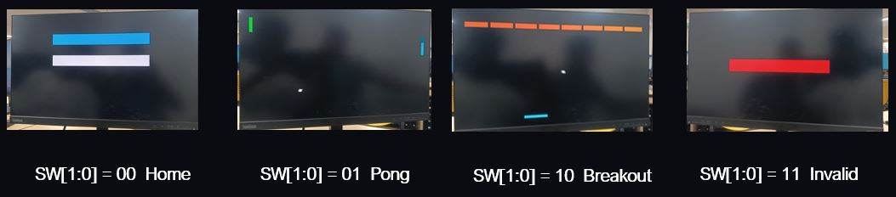
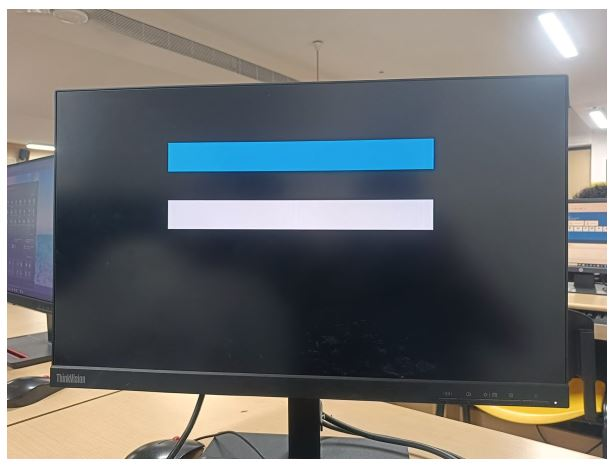
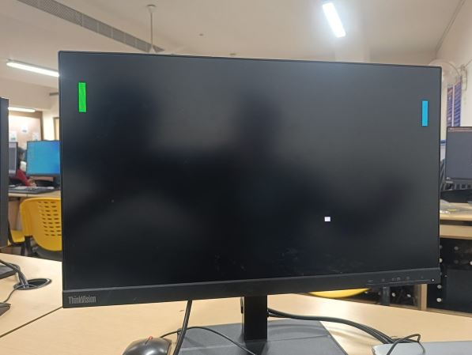
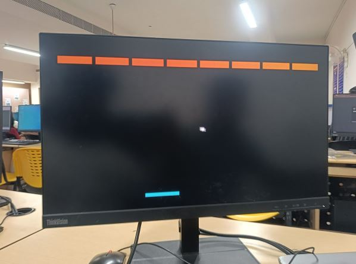
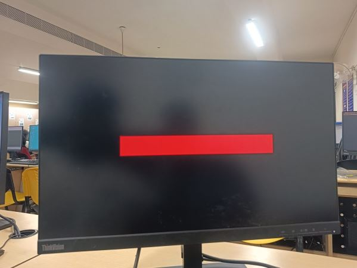
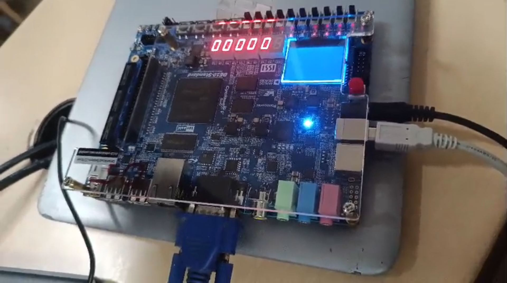
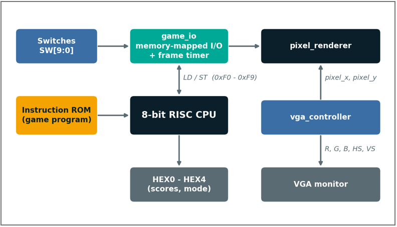

<div align="center">

# 8-Bit RISC CPU with Arcade Games

### A custom 8-bit processor, built from scratch in Verilog, that plays **Pong** and **Breakout** on a VGA monitor, running on an FPGA.


<!-- Replace the file name below with your best photo or GIF -->


</div>

---

## Overview

This project is a complete **8-bit single-cycle RISC processor** designed in Verilog and implemented on a **Terasic DE10** FPGA board. To prove the processor works as a real computer, it runs two arcade games, **Pong** and **Breakout**, and shows them on a **640 x 480 VGA** display.

The games are **not** dedicated hardware. They are a **225-instruction assembly program** stored in the CPU's instruction ROM and generated by a custom Python assembler. The CPU talks to the screen, switches and score displays through **memory-mapped I/O**, and a combinational pixel renderer turns the game registers into video with **no frame buffer**.

## Features

- **Custom 8-bit RISC CPU**: 13 instructions, 8 registers, zero and borrow flags
- **Single-cycle execution** (CPI = 1) at 50 MHz, which is 50 million instructions per second
- **Memory-mapped I/O** with ten I/O addresses and a built-in 50 Hz frame timer
- **VGA 640 x 480 @ ~60 Hz** generated with no frame buffer
- **Two games** selected by switches: Pong (2 players) and Breakout (8 bricks)
- **Live scores** on the seven-segment displays
- **Custom two-pass assembler** that generates `instruction_rom.v` from assembly

## Gallery

| Home screen | Pong |
|:---:|:---:|
|  |  |
| **Breakout** | **Invalid input screen** |
|  |  |

| FPGA setup | Block diagram |
|:---:|:---:|
|  |  |

## Controls

All controls use the slide switches on the DE10 board.

| Switch | Function |
|---|---|
| `SW[9]` | **Reset** (active high) |
| `SW[1:0]` | **Mode:** `00` Home, `01` Pong, `10` Breakout, `11` Invalid |
| `SW[2]` / `SW[3]` | Pong: paddle 1 up / down. Breakout: paddle left / right |
| `SW[4]` / `SW[5]` | Pong: paddle 2 up / down |

**Seven-segment displays** (hexadecimal): `HEX1:HEX0` show player 1 (or the Breakout score), `HEX3:HEX2` show player 2, and `HEX4` shows the current mode.

## System architecture

```
                 ┌──────────────────────── CPU ────────────────────────┐
                 │                                                     │
                 │  PC ──► Instruction ──► Decoder ──► Control Unit    │
                 │  ▲         ROM                          │           │
                 │  └── jump / PC+1                        ▼           │
                 │                          Register File ◄► ALU       │
                 │                          (8 x 8-bit)   (Z, C flags) │
                 └───────────────────────────┬─────────────────────────┘
                                             │ LD / ST
                          ┌──────────────────┴──────────────────┐
                    0x00-0xEF                              0xF0-0xF9
                    Data RAM                             game_io (MMIO)
                   (256 bytes)                                │
                                        ┌─────────────────────┼──────────────┐
                                        ▼                     ▼              ▼
                                 Switches / Timer       Pixel Renderer   7-Segment
                                                              │            Displays
                                                        VGA Controller
                                                              │
                                                         VGA Monitor
```

The processor never draws on screen directly. It stores the ball position, paddle positions, scores and brick bits into registers inside `game_io`, and `pixel_renderer` converts those numbers into pixels. The 256 x 192 game area is scaled to the screen, so each game pixel covers 2.5 x 2.5 screen pixels.

## Processor specification

| Parameter | Value |
|---|---|
| Data width | 8 bits |
| Instruction width | 16 bits |
| Registers | 8 general-purpose (`r0` to `r7`), 8 bits each |
| Instruction memory | 256 x 16 bits (program uses 225 locations) |
| Data memory | 256 x 8 bits (`0x00-0xEF` RAM, `0xF0-0xFF` I/O) |
| Flags | Zero (Z) and carry / borrow (C) |
| Execution | Single cycle, CPI = 1 |
| Clock | 50 MHz |

### Instruction format

```
 15      12 11     9 8      6 5      3 2      0
┌──────────┬────────┬────────┬────────┬────────┐
│  opcode  │   rd   │   ra   │   rb   │   -    │
└──────────┴────────┴────────┴────────┴────────┘
                       └─── imm / address / ───┘
                           jump target [7:0]
```

### Instruction set

| Mnemonic | Opcode | Operation | Flags |
|---|---|---|---|
| `LDI rd, imm` | `0001` | rd = imm | - |
| `ADD rd, ra, rb` | `0010` | rd = ra + rb | Z, C |
| `SUB rd, ra, rb` | `0011` | rd = ra - rb (C = 1 when ra < rb) | Z, C |
| `AND rd, ra, rb` | `0100` | rd = ra AND rb | Z |
| `OR rd, ra, rb` | `0101` | rd = ra OR rb | Z |
| `XOR rd, ra, rb` | `0110` | rd = ra XOR rb | Z |
| `JMP addr` | `0111` | PC = addr | - |
| `BZ addr` | `1000` | if Z = 1 then PC = addr | - |
| `LD rd, addr` | `1001` | rd = memory or I/O at addr | - |
| `ST rs, addr` | `1010` | memory or I/O at addr = rs | - |
| `HALT` | `1011` | stop the processor | - |
| `BNZ addr` | `1100` | if Z = 0 then PC = addr | - |
| `BC addr` | `1101` | if C = 1 then PC = addr | - |

Encoding examples from the generated ROM: `LDI r1, 120` = `0x1278`, `ADD r1, r1, r2` = `0x2250`, `ST r1, BALL_Y` = `0xA1F3`.

### Memory-mapped I/O map

| Address | Name | Access | Description |
|---|---|---|---|
| `0xF0` | MODE | Read | `SW[1:0]`: 00 home, 01 Pong, 10 Breakout, 11 invalid |
| `0xF1` | CTRL | Read | `SW[5:2]`: the four game buttons |
| `0xF2` | BALL_X | R/W | Ball X position |
| `0xF3` | BALL_Y | R/W | Ball Y position |
| `0xF4` | PAD1 | R/W | Paddle 1 (Pong: vertical, Breakout: horizontal) |
| `0xF5` | PAD2 | R/W | Paddle 2 (Pong: vertical) |
| `0xF6` | SCORE1 | R/W | Score 1 (`HEX1:HEX0`) |
| `0xF7` | SCORE2 | R/W | Score 2 (`HEX3:HEX2`) |
| `0xF8` | BRICKS | R/W | One bit per brick, 1 = present |
| `0xF9` | TICK | R/W | Read: 1 when a new frame is due. Write: clears the flag |

## Software design tricks

- `r0` always holds **0** and `r7` always holds **1**, which acts as a software zero register and constant one.
- Directions are stored as `1` or `255` (which is -1 in 8-bit maths), so moving the ball is a single `ADD`.
- **Equality test:** `SUB` then `BZ` / `BNZ`. **Less-than test:** `SUB` then `BC`.
- **Test a register against zero:** `OR r, r, r` sets the flag without changing the value.
- **Shift left by one:** `ADD r, r, r`, used to walk a bit mask across the eight bricks.
- The CPU is idle more than **99.98%** of the time (the longest frame needs 173 of 1,000,000 cycles), which leaves lots of room for more games.

## Repository structure

```
8-Bit-RISC-CPU-with-Arcade-Game/
├── src/
│   ├── RISC_Arcade.v           # Top level: switches, VGA, 7-segment, CPU hookup
│   ├── cpu.v                   # CPU datapath, flags, RAM / I/O selection
│   ├── program_counter.v       # 8-bit program counter
│   ├── instruction_rom.v       # Game program (generated by the assembler)
│   ├── instruction_decoder.v   # Splits the instruction into fields
│   ├── control_unit.v          # Opcode to control signals
│   ├── register_file.v         # 8 x 8-bit registers
│   ├── alu.v                   # ADD / SUB / AND / OR / XOR / PASS + flags
│   ├── data_memory.v           # 256-byte RAM
│   ├── game_io.v               # Memory-mapped I/O + 50 Hz frame timer
│   ├── vga_controller.v        # 640x480 timing, pixel_x / pixel_y
│   └── pixel_renderer.v        # Draws paddles, ball and bricks per pixel
├── docs/
│   └── images/                 # Photos and diagrams used in this README
├── LICENSE
└── README.md
```

## Getting started

### Requirements

- Terasic **DE10** FPGA board (or any board with a 50 MHz clock, switches, 7-segment displays and VGA)
- **Intel Quartus Prime**
- A VGA monitor and cable

### Build and run

1. Open **Quartus Prime** and create a new project for your board's FPGA.
2. Add all the files in `src/` to the project.
3. Set **`RISC_Arcade`** as the top-level entity.
4. Assign pins for `CLOCK_50`, `SW`, `KEY`, `VGA_*` and `HEX0` to `HEX5` using your board's pin file.
5. Compile, then program the board over USB-Blaster.
6. Connect the VGA monitor, toggle `SW[9]` high then low to reset, and pick a screen with `SW[1:0]`.

## Future improvements

- Add more games (Snake, Space Invaders)
- Extend the program counter to 16 bits for larger programs
- Add a pipeline to raise the clock speed
- Add sound output
- Add a PS/2 keyboard or push-button controls instead of switches

## Author

**Surya R**

- GitHub: [@suryar3833](https://github.com/suryar3833)
- Email: suryar3833@gmail.com

## License

This project is licensed under the **MIT License**. See the [LICENSE](LICENSE) file for details.

---
